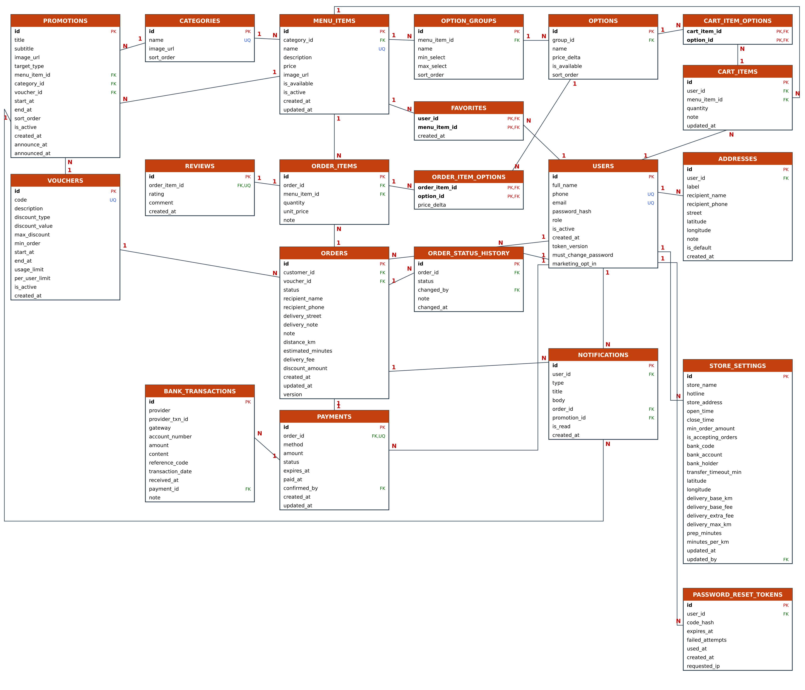

# Cơ sở dữ liệu – Atlas Restaurant

CSDL PostgreSQL cho ứng dụng đặt món giao tận nhà của một nhà hàng. Khách thanh toán bằng tiền mặt khi nhận hàng (COD) hoặc chuyển khoản VietQR (SePay tự xác nhận). Schema do Flyway quản lý: `backend/src/main/resources/db/migration/V1__init.sql` (lõi) `V2__payments_options_notifications_promotions.sql` (thanh toán, tùy chọn món, thông báo, chương trình quảng bá) và `V3__password_reset_and_marketing_rules.sql` (quên mật khẩu, thu hồi phiên đăng nhập, quy tắc gửi khuyến mãi). Hibernate chạy ở chế độ `ddl-auto=validate`: nếu entity lệch với schema thì app không khởi động.

Mã nguồn ERD dạng DBML: [`erd.dbml`](erd.dbml) – dán vào https://dbdiagram.io/d để xem và chỉnh sơ đồ.

**21 bảng, 30 khóa ngoại.** Bảng nào cũng có quan hệ với ít nhất một bảng khác, và cột khóa ngoại nào cũng có index (đã kiểm tra tự động trên PostgreSQL).

## Các bảng

| Bảng | Ý nghĩa | Khóa | Quan hệ |
|---|---|---|---|
| `users` | Mọi tài khoản: khách hàng, nhân viên, bếp, quản lý. `token_version` để thu hồi mọi phiên đăng nhập khi đổi/đặt lại mật khẩu; `must_change_password` sau khi quản lý cấp mật khẩu tạm; `marketing_opt_in` là đồng ý nhận khuyến mãi | `id`; unique `phone`, `email` | 1–N `addresses`, `cart_items`, `favorites`, `orders` (khách), `order_status_history` (người đổi trạng thái), `store_settings` (người sửa) |
| `addresses` | Sổ địa chỉ của khách: dòng địa chỉ và vị trí trên bản đồ (`latitude`, `longitude`), có một địa chỉ mặc định. Phí và thời gian giao tính từ vị trí so với nhà hàng nên không lưu ở đây | `id` | N–1 `users` (xóa theo user) |
| `categories` | Danh mục món | `id`; unique `name` | 1–N `menu_items` |
| `menu_items` | Món ăn. `is_available` là còn hàng hôm nay, `is_active` là còn trong thực đơn | `id`; unique `name` | N–1 `categories`; 1–N `order_items`, `cart_items`, `favorites` |
| `option_groups` | Nhóm tùy chọn của món, ví dụ "Size" (chọn đúng 1) hoặc "Topping" (tối đa 3); `min_select`, `max_select` | `id`; unique `(menu_item_id, name)` | N–1 `menu_items` (xóa theo) |
| `options` | Một lựa chọn trong nhóm, có giá cộng thêm `price_delta`, `is_available` | `id`; unique `(group_id, name)` | N–1 `option_groups` |
| `favorites` | Món yêu thích của khách | `(user_id, menu_item_id)` | Bảng nối N–N giữa `users` và `menu_items` |
| `cart_items` | Dòng giỏ hàng trên máy chủ, giữ nguyên khi đổi thiết bị. Cùng một món có thể nằm ở hai dòng nếu khác tùy chọn | `id` | N–1 `users` (xóa theo), N–1 `menu_items` |
| `cart_item_options` | Tùy chọn đã chọn cho một dòng giỏ hàng | `(cart_item_id, option_id)` | Bảng nối N–N giữa `cart_items` và `options` |
| `vouchers` | Mã giảm giá: theo % (có mức giảm tối đa) hoặc số tiền; đơn tối thiểu, thời hạn, giới hạn lượt dùng tổng và theo từng khách | `id`; unique `code` | 1–N `orders` |
| `orders` | Đơn giao hàng | `id` | N–1 `users`, `vouchers`; 1–N `order_items`, `order_status_history` |
| `order_items` | Các dòng món trong đơn; `unit_price` là giá gốc lúc đặt | `id` | N–1 `orders`, `menu_items`; 1–1 `reviews` |
| `order_item_options` | Tùy chọn của một dòng đơn, kèm giá cộng thêm lúc đặt | `(order_item_id, option_id)` | Bảng nối N–N giữa `order_items` và `options` |
| `payments` | Thanh toán của đơn (mỗi đơn đúng một bản ghi): phương thức COD hoặc BANK_TRANSFER, số tiền, trạng thái chờ / đã thanh toán / thất bại / chờ hoàn / đã hoàn, hạn chuyển khoản, người xác nhận | `id`; unique `order_id` | 1–1 `orders`; N–1 `users`; 1–N `bank_transactions` |
| `bank_transactions` | Mọi giao dịch tiền vào tài khoản quán do SePay báo về, kể cả giao dịch không khớp đơn nào | `id`; unique `(provider, provider_txn_id)` | N–1 `payments` (có thể rỗng) |
| `order_status_history` | Nhật ký đổi trạng thái: ai đổi, lúc nào, lý do. Màn hình theo dõi đơn hiển thị từ bảng này | `id` | N–1 `orders`, N–1 `users` |
| `reviews` | Đánh giá 1–5 sao cho từng món trong đơn đã giao | `id`; unique `order_item_id` | 1–1 `order_items` |
| `password_reset_tokens` | Mã OTP 6 số để đặt lại mật khẩu (chỉ lưu bản băm), hạn 10 phút, số lần nhập sai, thời điểm đã dùng | `id` | N–1 `users` (xóa theo) |
| `promotions` | Chương trình quảng bá hiển thị thành banner trong app, dẫn tới một món, một danh mục hoặc một mã giảm giá; có thời gian hiển thị; `announce_at` (hẹn gửi thông báo sau giờ yên lặng) và `announced_at` (đã gửi) | `id` | N–1 `menu_items`, `categories`, `vouchers` (đúng một tham chiếu tương ứng với `target_type`, kiểm tra bằng CHECK) |
| `notifications` | Thông báo trong app gửi khách: tiến trình đơn, thanh toán, chương trình mới | `id` | N–1 `users` (xóa theo), `orders`, `promotions` |
| `store_settings` | Cài đặt cửa hàng, chỉ có đúng một dòng (`id = 1`): giờ mở cửa, hotline, đơn tối thiểu, bật/tắt nhận đơn, tài khoản nhận chuyển khoản, **vị trí nhà hàng và bảng phí giao theo khoảng cách** (bán kính phí cơ bản, phí cơ bản, phụ phí mỗi km, phạm vi giao tối đa, thời gian chuẩn bị và di chuyển), hạn thanh toán | `id` | N–1 `users` (người sửa gần nhất) |

## Vì sao đạt 3NF

- **1NF:** mọi cột đều là giá trị nguyên tố. Không có danh sách hay JSON trong một ô. Mỗi món trong đơn là một dòng `order_items`, mỗi lần đổi trạng thái là một dòng `order_status_history`.
- **2NF:** các bảng có khóa ghép là `favorites`, `cart_item_options` và `order_item_options`. `favorites.created_at` và `order_item_options.price_delta` phụ thuộc vào cả cặp khóa, không chỉ một nửa. Các bảng còn lại dùng khóa đơn.
- **3NF:** không cột không khóa nào phụ thuộc bắc cầu qua một cột không khóa khác.
  - **Không lưu giá trị suy ra được.**
    - Tạm tính và tổng tiền của đơn tính từ `order_items`, `delivery_fee` và `discount_amount`.
    - Mã đơn hiển thị (`#DH1031-0007`) ghép từ ngày tạo và `id`.
    - Phương thức thanh toán chỉ nằm ở `payments` (đã bỏ khỏi `orders` ở V2). Nội dung chuyển khoản (`ATL` + mã đơn) và link ảnh QR được tạo từ mã đơn và tài khoản quán, không lưu.
    - Tên món, ảnh và tên danh mục trong đơn đọc qua khóa ngoại.
    - Điểm đánh giá trung bình của món tính bằng truy vấn.
  - **Không lặp khóa.** `reviews` chỉ trỏ tới `order_items`. Đơn, khách và món lấy qua dòng đơn, không lưu thêm `order_id` hay `menu_item_id`, vì làm vậy sẽ tạo phụ thuộc bắc cầu.
- **Các cột "chụp lại" lúc đặt hàng là dữ kiện của chính đơn đó,** không phải bản sao dư thừa:
  - `orders.recipient_name`, `recipient_phone`, `delivery_street`, `delivery_note` là địa chỉ thực tế đơn được giao tới. `orders` không có khóa ngoại tới `addresses`, nên khách sửa hay xóa sổ địa chỉ thì lịch sử đơn vẫn đúng.
  - `orders.delivery_fee` và `orders.discount_amount` là số tiền thực thu. `orders.distance_km` và `estimated_minutes` là quãng đường và thời gian giao đã hẹn lúc đặt. Bảng phí hay mã giảm giá có đổi sau này thì đơn cũ không bị đổi theo.
  - `order_items.unit_price` và `order_item_options.price_delta` là giá bán tại thời điểm đặt.
  - `payments.amount` là số tiền phải thu hoặc đã thu của lần thanh toán; `bank_transactions` lưu nguyên dữ liệu ngân hàng báo về để đối soát.
- `orders.status` là trạng thái hiện tại của đơn. `order_status_history` là một thực thể khác: các sự kiện thay đổi trạng thái, mỗi sự kiện có người thực hiện, thời điểm và lý do riêng.

## Ràng buộc nghiệp vụ ở mức CSDL

Mọi ràng buộc dưới đây cũng được kiểm tra ở API. CSDL giữ vai trò lớp bảo vệ cuối.

| Ràng buộc | Cài đặt |
|---|---|
| Giá trị liệt kê hợp lệ (vai trò, trạng thái đơn, loại giảm giá, phương thức thanh toán) | `CHECK ... IN (...)` |
| Số điện thoại 9–15 chữ số | `CHECK (phone ~ '^[0-9]{9,15}$')` |
| Giá, phí, giảm giá không âm; số lượng 1–99; điểm 1–5 | `CHECK` |
| Voucher %: không quá 100; ngày kết thúc sau ngày bắt đầu; giới hạn lượt dùng dương | `CHECK` |
| Mỗi khách có tối đa một địa chỉ mặc định | unique index một phần `ux_addresses_one_default ... where is_default` |
| Mỗi dòng đơn đánh giá tối đa một lần | `uk_reviews_order_item` |
| Giờ đóng cửa sau giờ mở cửa; bảng cài đặt chỉ có một dòng | `CHECK` |
| Hai nhân viên sửa cùng một đơn cùng lúc | khóa lạc quan qua cột `orders.version` |
| Mỗi đơn đúng một thanh toán; đã thanh toán thì phải có `paid_at` và ngược lại | `UNIQUE (order_id)`, `CHECK` |
| SePay gửi lại cùng một giao dịch không bị ghi trùng | `UNIQUE (provider, provider_txn_id)` |
| Nhóm tùy chọn: tối thiểu không vượt tối đa | `CHECK (max_select >= min_select)` |
| Chương trình chỉ tham chiếu đúng loại đích đã chọn | `CHECK` trên `target_type` và 3 khóa ngoại |
| Tài khoản ngân hàng nhập đủ cả mã ngân hàng và số tài khoản | `CHECK` trong `store_settings` |
| Vị trí là cặp (vĩ độ, kinh độ) đủ cả hai hoặc không có; phạm vi giao tối đa không nhỏ hơn bán kính phí cơ bản | `CHECK` trong `store_settings`, `addresses` |
| Mã đặt lại mật khẩu: tối đa 10 lần sai được ghi nhận, hạn sau thời điểm tạo | `CHECK` trong `password_reset_tokens` |

## Xóa dữ liệu

| Dữ liệu | Khi xóa |
|---|---|
| Tài khoản khách | Xóa theo (`ON DELETE CASCADE`) sổ địa chỉ, giỏ hàng, món yêu thích. Đơn hàng cũ không bị xóa: khóa ngoại `RESTRICT` chặn lại, nên ứng dụng khóa tài khoản (`is_active = false`) thay vì xóa |
| Món đã từng được đặt, voucher đã dùng | Không xóa được; ứng dụng chuyển sang "ngừng bán" hoặc "ngừng áp dụng" (`is_active = false`) |
| Tùy chọn món đã có trong đơn | Không xóa được (khóa ngoại từ `order_item_options`); quản lý tắt "còn" thay vì xóa |
| Chương trình quảng bá | Xóa được; thông báo đã gửi giữ nguyên nội dung, chỉ mất liên kết (`ON DELETE SET NULL`) |
| Món bị xóa hẳn (chưa từng được đặt) | Tự gỡ khỏi giỏ hàng và danh sách yêu thích |

Nhờ vậy không bao giờ có dòng mồ côi, tức dòng trỏ tới bản ghi không còn tồn tại.

## Giao hàng tính theo khoảng cách

Nhà hàng có một vị trí duy nhất (Trường Đại học CMC - Cơ sở 2, Vạn Phúc Building, Hà Đông, Hà Nội); khách chọn vị trí giao bằng tìm địa chỉ hoặc GPS. Không còn danh sách quận cố định vì các đơn vị hành chính đã thay đổi sau sáp nhập. Quy tắc (cấu hình trong `store_settings`, quản lý chỉnh được):

| Quy tắc | Mặc định |
|---|---|
| Quãng đường | khoảng cách chim bay x 1,3 (hệ số đường đi), làm tròn lên 0,1 km |
| Phí trong bán kính cơ bản | 15.000đ cho 5 km đầu |
| Phụ phí | 5.000đ mỗi km bắt đầu vượt 5 km, làm tròn lên 1.000đ |
| Giao xa nhất | 15 km, xa hơn không giao |
| Thời gian dự kiến | 15 phút chuẩn bị + 4 phút mỗi km |

Ví dụ: 9,5 km đường đi thì 15.000đ + 5 km bắt đầu vượt (4,5 làm tròn lên 5) x 5.000đ = 40.000đ, giao trong khoảng 53 phút. Cách tính nằm ở `DeliveryService`; phí đã tính được chụp lại trong đơn.
